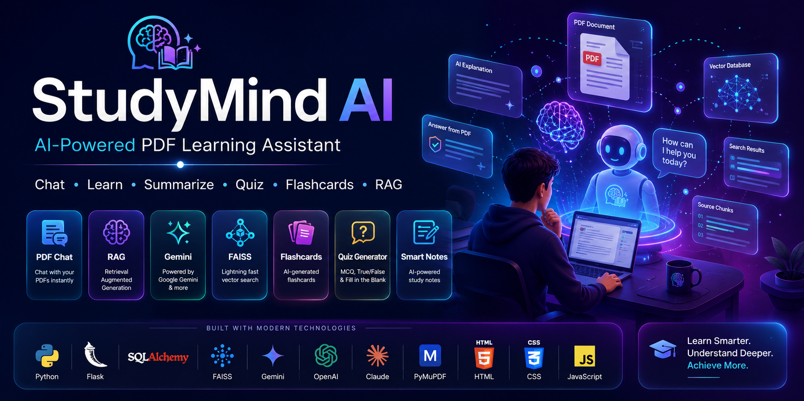

<div align="center">

# 📚 StudyMind AI

### AI-Powered PDF Learning Assistant with RAG, Multi-Provider LLM Support & Intelligent Study Tools

<p align="center">
An advanced AI learning platform that transforms PDFs into an interactive learning experience using Retrieval-Augmented Generation (RAG), vector search, and modern Large Language Models.
</p>

<p align="center">


</p>

<p align="center">



</p>

</div>

---

# 🚀 Overview

StudyMind AI is a full-stack AI-powered learning platform that allows users to upload PDF documents and interact with them using natural language.

Instead of manually searching through hundreds of pages, users can simply ask questions and receive accurate answers generated using **Retrieval-Augmented Generation (RAG)**.

Unlike traditional AI chatbots, StudyMind AI provides **Dual Answer Mode**, ensuring every response contains:

- 📄 **Answer From PDF** — Grounded strictly in the uploaded document.
- 🤖 **AI Explanation** — A simplified explanation generated by the selected LLM.

This approach improves transparency, reduces hallucinations, and helps users understand complex topics more effectively.

---

# ✨ Key Features

## 🔐 Authentication

- Secure Registration & Login
- Email Verification
- Forgot Password
- Password Reset
- Profile Management
- Session Authentication
- Protected Routes

---

## 📚 PDF Management

- Upload PDF Files
- Drag & Drop Support
- Rename PDFs
- Delete PDFs
- Download PDFs
- Favorites
- Search
- Sort
- Filters
- Processing Status

---

## 🧠 AI Chat

- ChatGPT-style Interface
- Markdown Rendering
- Syntax Highlighting
- Code Block Support
- Copy Responses
- Edit Messages
- Delete Messages
- Regenerate Responses
- Pin Important Chats
- Export Conversations
- Conversation History

---

## 🔍 Retrieval-Augmented Generation (RAG)

StudyMind AI uses an end-to-end Retrieval-Augmented Generation pipeline.

```
Upload PDF
      │
      ▼
Extract Text
      │
      ▼
Clean Text
      │
      ▼
Chunking
      │
      ▼
Generate Embeddings
      │
      ▼
Store in FAISS
      │
      ▼
Semantic Search
      │
      ▼
Context Retrieval
      │
      ▼
LLM Response
```

Each user query retrieves only the most relevant document chunks before sending them to the AI model, improving accuracy while reducing hallucinations.

---

# 🎯 Dual Answer Mode

Every response contains two independent answers.

### 📄 Answer From PDF

- Based only on retrieved document chunks
- Includes citations
- Confidence score
- Prevents hallucinations

### 🤖 AI Explanation

- Easy-to-understand explanation
- Beginner-friendly language
- Additional context
- Learning-focused

This allows users to verify the original answer while also receiving a simplified explanation.

---

# 🤖 Supported AI Providers

StudyMind AI supports multiple AI providers through a unified provider interface.

| Provider | Chat | Embeddings |
|-----------|------|------------|
| Google Gemini | ✅ | ✅ |
| OpenAI | ✅ | ✅ |
| Anthropic Claude | ✅ | ❌ |

Switching providers requires **no code changes**.

Simply configure an API key inside `.env`.

```env
AI_PROVIDER=auto

GEMINI_API_KEY=your_key

OPENAI_API_KEY=

ANTHROPIC_API_KEY=
```

The application automatically detects the available provider.

---

# 🎓 AI Study Tools

StudyMind AI includes numerous AI-powered educational tools.

- 📄 Document Summaries
- 📝 Smart Notes
- 🧠 Flashcards
- ❓ Quiz Generator
- 📌 Important Questions
- 💼 Interview Questions
- 🎯 Learning Objectives
- 🗺️ Mind Maps
- 👶 Explain Like I'm 10
- 📈 Difficulty Analysis
- 🔑 Topic Extraction
- 🏷️ Keyword Extraction

These tools are generated directly from the uploaded PDF using the configured AI provider.

---

# 🖥️ Screenshots

| Dashboard | AI Chat |
|------------|---------|
|  |  |

| Upload PDF | Study Tools |
|------------|-------------|
|  |  |

---

# ⭐ Why StudyMind AI?

Unlike traditional PDF readers or generic AI chatbots, StudyMind AI combines:

- Retrieval-Augmented Generation (RAG)
- Vector Search using FAISS
- Multiple AI Providers
- Modern Authentication
- Interactive Learning Tools
- Beautiful Responsive Interface

into one complete AI learning platform.

---
# 🏗️ System Architecture

StudyMind AI follows a modular architecture designed for scalability, maintainability, and future AI provider integrations.

```
                    ┌────────────────────┐
                    │      Browser       │
                    └─────────┬──────────┘
                              │
                     HTTP / HTTPS Requests
                              │
                              ▼
                   ┌──────────────────────┐
                   │     Flask Server      │
                   └─────────┬─────────────┘
                             │
        ┌────────────────────┼────────────────────┐
        │                    │                    │
        ▼                    ▼                    ▼
 Authentication        PDF Processing       AI Services
        │                    │                    │
        ▼                    ▼                    ▼
 Database            Text Extraction        AI Provider
(SQLAlchemy)         Chunk Creation         (Gemini/OpenAI/Claude)
        │                    │                    │
        └──────────────┬─────┴──────────────┬─────┘
                       ▼                    ▼
                  FAISS Vector DB      Response Generator
                       │
                       ▼
                 Dual Answer Mode
```

---

# ⚙️ How StudyMind AI Works

## Step 1 — Upload PDF

The user uploads one or more PDF documents.

↓

## Step 2 — Text Extraction

PyMuPDF extracts all readable text.

↓

## Step 3 — Cleaning

The extracted text is cleaned by removing unnecessary formatting.

↓

## Step 4 — Chunking

Large documents are split into smaller semantic chunks.

↓

## Step 5 — Embedding Generation

Each chunk is converted into high-dimensional vectors.

↓

## Step 6 — Vector Storage

Vectors are stored inside a FAISS index for fast semantic search.

↓

## Step 7 — User Question

The user asks a question in natural language.

↓

## Step 8 — Semantic Search

The question is embedded and compared with all stored vectors.

↓

## Step 9 — Context Retrieval

Top-K most relevant chunks are retrieved.

↓

## Step 10 — AI Generation

The retrieved context is sent to the configured AI provider.

↓

## Step 11 — Dual Answer

StudyMind AI returns

- 📄 Answer From PDF
- 🤖 AI Explanation

along with

- Confidence Score
- Source References

---

# 📂 Project Structure

```text
StudyMind-AI/

├── app/
│   ├── models/
│   ├── routes/
│   ├── services/
│   ├── static/
│   ├── templates/
│   ├── utils/
│   └── config.py
│
├── uploads/
├── indexes/
├── processed_data/
├── instance/
│
├── screenshots/
│
├── requirements.txt
├── run.py
├── README.md
└── .env.example
```

---

# 🛠️ Tech Stack

## Backend

- Python
- Flask
- SQLAlchemy
- Flask Login
- Flask Mail
- Flask WTF
- Flask Migrate
- Flask Limiter

---

## Artificial Intelligence

- Google Gemini
- OpenAI
- Anthropic Claude
- Retrieval-Augmented Generation (RAG)
- FAISS
- Embedding Models

---

## Document Processing

- PyMuPDF
- PDF Text Extraction
- Semantic Chunking

---

## Database

- SQLite
- PostgreSQL

---

## Frontend

- HTML5
- CSS3
- JavaScript
- Jinja2
- Markdown Rendering
- Highlight.js

---

# 📊 Database Design

The application contains multiple relational tables.

```
Users
   │
   ├── PDFs
   │      │
   │      ├── Chunks
   │      ├── Chats
   │      │      │
   │      │      └── Messages
   │      │
   │      ├── Flashcards
   │      ├── Quizzes
   │      ├── Bookmarks
   │      └── Study Sessions
   │
   └── User Settings
```

---

# 🚀 Installation

## Clone Repository

```bash
git clone https://github.com/yourusername/StudyMind-AI.git

cd StudyMind-AI
```

---

## Create Virtual Environment

Windows

```bash
python -m venv venv

venv\Scripts\activate
```

Linux / macOS

```bash
python3 -m venv venv

source venv/bin/activate
```

---

## Install Dependencies

```bash
pip install -r requirements.txt
```

---

## Configure Environment Variables

Copy

```text
.env.example
```

Rename it to

```text
.env
```

Fill in

- SECRET_KEY
- At least one AI Provider API Key

Example

```env
AI_PROVIDER=auto

GEMINI_API_KEY=YOUR_KEY

OPENAI_API_KEY=

ANTHROPIC_API_KEY=
```

---

## Initialize Database

```bash
flask --app run.py init-db
```

---

## Start Application

```bash
python run.py
```

Visit

```
http://127.0.0.1:5000
```

Register an account, verify your email, and begin chatting with your PDFs.

---

# 📖 Usage

1. Create an account
2. Verify your email
3. Login
4. Upload a PDF
5. Wait for processing
6. Open the chat
7. Ask questions
8. Generate summaries
9. Create flashcards
10. Generate quizzes
11. Export your learning materials

---

# 🔒 Security

StudyMind AI follows several security best practices.

- Password hashing using Werkzeug
- Email verification
- Password reset tokens
- CSRF protection
- Rate limiting
- Protected routes
- Ownership validation
- SQLAlchemy ORM
- Secure session management
- File upload validation

---

# 🚀 Deployment

StudyMind AI can be deployed using

- Render
- Railway
- DigitalOcean
- AWS
- Azure
- Google Cloud
- Docker
- VPS

Production recommendations

- PostgreSQL
- Gunicorn
- Nginx
- HTTPS
- Object Storage
- Redis
- Background Workers

---

# 🗺️ Roadmap

Planned future improvements

- Live Streaming Responses
- OCR Support
- Voice Conversations
- Mobile Application
- Multi-language Support
- Team Workspaces
- Cloud Synchronization
- AI Note Generator
- AI Presentation Generator
- AI Homework Assistant
- Collaborative Learning
- Real-time Notifications

---

# 🤝 Contributing

Contributions are welcome.

If you'd like to improve StudyMind AI:

1. Fork the repository.

2. Create a new branch.

```bash
git checkout -b feature-name
```

3. Commit your changes.

```bash
git commit -m "Added awesome feature"
```

4. Push your branch.

```bash
git push origin feature-name
```

5. Open a Pull Request.

Please read **CONTRIBUTING.md** before submitting.

---

# 📄 License

This project is licensed under the MIT License.

See the **LICENSE** file for more information.

---

# 👨‍💻 Author

## Abaid-ur-Rehman

Machine Learning Engineer • AI Developer • Python Developer

### Connect with me

- GitHub: https://github.com/yourusername
- LinkedIn: https://linkedin.com/in/yourprofile

---

<div align="center">

### ⭐ If you found this project helpful, consider giving it a star!

**StudyMind AI — Learn Smarter with Artificial Intelligence**

Made with ❤️ using Python, Flask, RAG & Large Language Models.

</div>